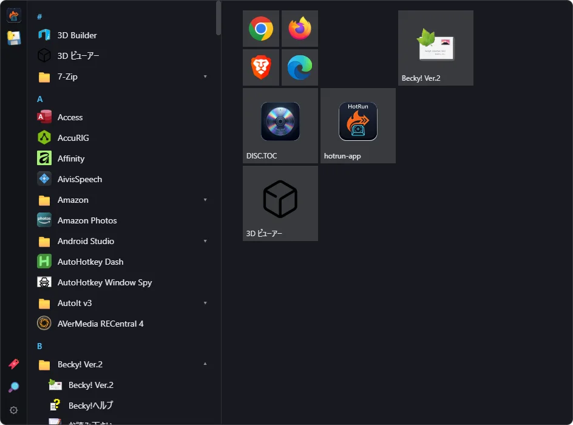

# DDlauncher

Win10風のタイル型スタートメニューランチャー。Explorerの内部に依存しない、独立アプリです（Tauri v2 / Rust + HTML・CSS・JS）。
2002年に作った同名ランチャーの作り直しで、旧作とは別物です。

**v0.1.0**（初版）。Windows 11（25H2）で動作確認しています。Windows 10 は未確認です。




## できること
- **アプリ一覧**: スタートメニューの `.lnk` とストアアプリを、頭文字の見出し・フォルダ展開つきで一覧。日本語名・アイコン対応。クリックで起動。
- **最近使った**: 一覧の先頭に、最近起動したアプリ。
- **タイル**: 一覧を右クリックでピン留め、または一覧からドラッグ。ドラッグで配置、サイズ変更（小・中・横長・大）、隙間を保持する配置、保存。
- **ドロップで追加**: エクスプローラーの exe・フォルダ・ショートカットをタイル領域にドロップ。
- **検索**: 🔎、Ctrl+S、または文字キーを打つと検索欄。前方一致が上、途中一致が下。↑↓ と Enter で起動。
- **ブックマーク**: 🔖 のリスト。アプリ・フォルダ・コマンド（複数行・作業フォルダ指定）を、グループ（フォルダ）に分けて登録。
- **左端のアイコン列**: よく使うものを並べる。ドロップで追加。
- **グローバルホットキー**: どのアプリが前面でも開閉。開いたら検索欄から始められる。
- **常駐**: タスクトレイのアイコン、Windows 起動時の自動起動、ピン止めアイコンからの開閉。
- **バックアップ**: 設定・タイル・左端・ブックマークを1つの JSON に書き出し／読み込み。
- 表示位置（左右下・上・中央・カーソル位置）、透明度、フォーカスが外れたら閉じる、など。

使い方は `docs/usage.md`、変更点は `CHANGELOG.md`。ビルドの注意は `docs/build-notes.md`。

## インストール
`npm run installer` で作った `src-tauri/target/release/bundle/nsis/DDlauncher_0.1.0_x64-setup.exe` を実行します（管理者権限は不要。ユーザー単位でインストールされます）。
インストーラーを使わず、`ddlauncher.exe` をそのまま置いて使うこともできます。

## ビルド（Windows）
必要なもの: Rust（MSVC）、Node.js、WebView2

```
npm install
npm run tauri dev        # 動作確認。ただしピン止めの確認はできない（下のexeで行う）
npm run build            # src-tauri/target/release/ddlauncher.exe ができる（インストーラーなし）
npm run installer        # NSIS のインストーラーも作る
```

ビルドの前には、起動中の DDlauncher を必ず終了しておく
（起動中は exe が使われていて、`アクセスが拒否されました (os error 5)` で置き換えられない）。
終了は、タスクトレイのアイコン →「終了」、または設定の「アプリを終了」。

## タスクバーへのピン止め
ピン止めは手動です。`ddlauncher.exe`（またはスタートメニューのショートカット）を右クリック →（Win11 は「その他のオプションを確認」）→「タスクバーにピン留めする」。
自動でピン止めする公式 API（`TaskbarManager`）はありますが、自作の未パッケージアプリでは `IsPinningAllowed=false` で動きませんでした（`docs/tiles-test.md` に記録）。
ウィンドウはタスクバーに出さない設定のため、ピン止めしたアイコンを押すたびに exe が再起動され、
常駐している側へ知らせて、2回目のプロセスは終了します（single-instance）。ピン止めを外しても、トレイから使えます。

## データの場所
- `%APPDATA%\com.fixtan.ddlauncher\` : `settings.json`（設定）、`tiles.json`（タイル）、`rail.json`（左端）、`bookmarks.json`（ブックマーク）、`usage.json`（起動履歴）
  書き込みは一時ファイル経由で、直前の内容を `.bak` に1世代残します。
- `%LOCALAPPDATA%\com.fixtan.ddlauncher\icons\` : アイコンのキャッシュ。消しても、次に表示するとき作り直されます。
- `%TEMP%\ddlauncher\` : ブックマークのコマンドを実行するための一時 `.bat`（1日で自動削除）。

## 制限・既知の点
- 引数付きのアプリ起動は、ブックマークの「コマンド」で書く（例: `"C:\Tools\app.exe" --flag`）。
- コマンドは cmd.exe で実行します。PowerShell・管理者での実行は未対応。
- アンインストールしても、自動起動の登録（レジストリの Run）は残る場合があります。設定で自動起動をオフにしてから消してください。
- ホットキーに Win キーは使えません（OS が使うため）。

## 開発メモ
要件は `docs/requirements.md`、配置エンジンの試作とテストは `docs/prototype/`
（`node docs/prototype/test-engine.js src/tile-engine.js`）、
動作確認の観察項目は `docs/open-close-test.md`、`docs/apps-list-test.md`、`docs/tiles-test.md`（#1〜129）。

## ライセンス
MIT License（`LICENSE` を参照）。
